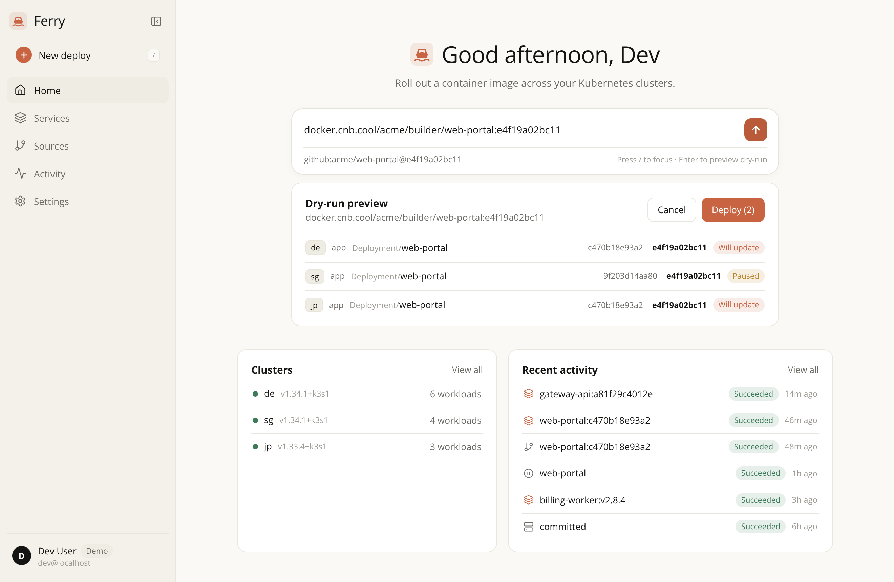
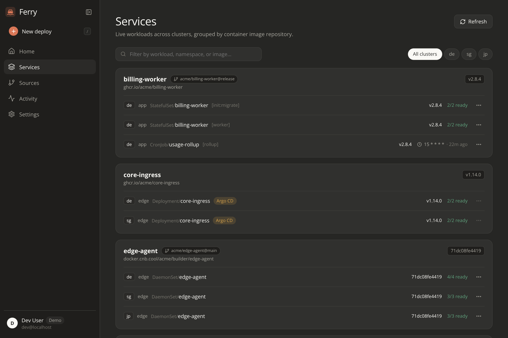

# Ferry

Ferry is a single-binary Kubernetes image rollout controller, build coordinator, and GitOps snapshotter with a calm web UI across multiple clusters.



<details>
<summary>Dark mode — Services inventory grouped by image repository</summary>



</details>

---

## Quickstart (30 seconds, no cluster needed)

Run Ferry in `-demo` mode to launch three in-memory fake Kubernetes clusters (`de`, `sg`, `jp`) populated with Deployments, a StatefulSet, a DaemonSet, a CronJob, an Argo CD-managed service, and a paused rollout:

```bash
make demo
# Open http://localhost:8080
```

Or build and run with Docker:

```bash
docker build -t ferry:local .
docker run --rm -p 8080:8080 ferry:local -demo
```

Press `/` on the Home screen to focus the deploy composer, paste `docker.cnb.cool/acme/builder/web-portal:e4f19a02bc11`, press `Enter` to inspect the dry-run preview across clusters, and click **Deploy**.

---

## Core Concepts

- **Clusters & Namespaces** — Ferry talks directly to the Kubernetes REST API (`get`, `list`, `patch` only, no `client-go`) across an in-cluster ServiceAccount and any number of remote clusters.
- **Safe Image Rollouts** — Updates `Deployment`, `StatefulSet`, `DaemonSet`, and `CronJob` (`containers` and `initContainers`) using atomic RFC 6902 JSON Patch (`test` + `replace` + `kubernetes.io/change-cause` with `fieldManager=ferry`). Workloads carrying `argocd.argoproj.io/tracking-id` are skipped automatically; workloads annotated with `ferry.star.moe/auto-deploy: "false"` pause automatic CI rollouts while still allowing targeted single-service rollouts.
- **Sources & Builds** — Map `owner/repo@branch` to either **CNB** (shallow git mirror via `http.extraHeader` + `/-/build/start`) or **External CI** (GitHub Actions, GitLab CI, etc.). Build events automatically link to subsequent `/deploy` calls by commit tag.
- **OIDC & Scoped CI Auth** — Browser users sign in via OIDC Authorization Code + PKCE (`ES256`/`RS256` JWKS, Pocket ID / Dex / Keycloak / GitHub Enterprise OIDC) gated by `allowedGroups` or `allowedUsers`. CI pipelines authenticate with SHA-256-hashed `fy_...` deploy tokens or `gitRead` repository tokens.
- **Cluster Snapshots** — Periodically exports cleaned workload/network manifests and SOPS (`age`)-encrypted Secrets to a Git repository, re-encrypting Secrets only when their plaintext SHA-256 changes.

---

## Deploying to Kubernetes

1. **Apply namespace-scoped RBAC** (`get`/`list`/`patch` only; separate optional Role for snapshots):

   ```bash
   kubectl apply -f deploy/rbac.yaml
   # On each remote cluster (e.g. sg, jp):
   kubectl apply -f deploy/remote-cluster-rbac.yaml
   ```

2. **Create `ferry.yaml`** (see [`deploy/ferry.example.yaml`](deploy/ferry.example.yaml) for all options; `${VAR}` placeholders expand from environment variables at startup):

   ```yaml
   listen: ":8080"

   auth:
     sessionKey: "${SESSION_KEY}"
     oidc:
       issuer: "https://id.example.com"
       clientID: "ferry"
       clientSecret: "${OIDC_CLIENT_SECRET}"
       publicURL: "https://ferry.example.com"
       allowedGroups: ["ops"]

   state:
     kubernetes:
       namespace: "app"
       name: "ferry-state"

   namespaces: ["app"]

   clusters:
     - name: de
       inCluster: true
     - name: sg
       server: "https://k8s-sg.example.com:6443"
       caFile: "/secrets/clusters/sg.ca"
       tokenFile: "/secrets/clusters/sg.token"
   ```

3. **Deploy Ferry**:

   ```bash
   kubectl apply -f deploy/deployment.yaml
   ```

   Ferry runs as UID `65532:65532` with `readOnlyRootFilesystem: true`, `allowPrivilegeEscalation: false`, and all Linux capabilities dropped. No external database or Redis is required: sources, hashed deploy tokens, and the 300-event activity ring buffer live in the `ferry-state` ConfigMap (with optimistic `resourceVersion` conflict retry).

---

## Connecting CI

Create a deploy token in **Settings → Deploy tokens**, store it as `FERRY_TOKEN` in your CI secrets, and notify Ferry after pushing your container image:

### `curl`

```bash
curl -fsS -X POST "https://ferry.example.com/deploy" \
  -H "Authorization: Bearer ${FERRY_TOKEN}" \
  -H "Content-Type: application/json" \
  -d "{\"image\":\"ghcr.io/org/service\",\"tag\":\"${GIT_SHA:0:12}\",\"source\":\"github:org/service@${GIT_SHA:0:12}\"}"
```

### GitHub Actions

```yaml
- name: Roll out via Ferry
  env:
    FERRY_TOKEN: ${{ secrets.FERRY_TOKEN }}
    SHORT_SHA: ${{ github.sha }}
  run: |
    TAG="${SHORT_SHA:0:12}"
    curl -fsS -X POST "https://ferry.example.com/deploy" \
      -H "Authorization: Bearer ${FERRY_TOKEN}" \
      -H "Content-Type: application/json" \
      -d "{\"image\":\"ghcr.io/org/service\",\"tag\":\"${TAG}\",\"source\":\"github:${{ github.repository }}@${TAG}\"}"
```

`POST /deploy` returns HTTP `200` with the JSON array of per-workload results, or HTTP `500` (still returning the JSON results array) if any workload failed to patch.

---

## Migrating from `ci-relay`

Ferry is a drop-in replacement for `ci-relay` with zero changes required on external callers:

- **`POST /deploy`** — Accepts `{"image", "tag", "source"}` with `Authorization: Bearer <token>` (both `fy_...` deploy tokens and `auth.gitRead` repository tokens).
- **`POST /`** — Remains a full alias for `POST /webhook/github` (`X-Hub-Signature-256` HMAC verification), while `GET /` serves the web UI.
- **`POST /snapshot`** — Triggers an immediate snapshot and returns `{"status": "committed"|"unchanged", "commit": "<sha>"}`. Legacy single-namespace `secrets.enc.yaml` / `secrets.sha256` files are automatically migrated to `<namespace>.secrets.enc.yaml` / `<namespace>.secrets.sha256`.
- **`clustersFile` & `seedSources`** — Point `clustersFile` at an existing `CLUSTERS_FILE` JSON secret and `seedSources` at `repos.json` for automatic first-boot import.

---

## Architecture & Configuration Reference

See [`docs/DESIGN.md`](docs/DESIGN.md) for the complete architecture, HTTP API table, state schema, RBAC model, and security checklist.

## Development

```bash
# Build frontend and run all offline race-detector tests
cd web && npm ci && npm run build && cd ..
go vet ./...
go test -race ./...
```

## License

Licensed under the [Apache License, Version 2.0](LICENSE).
